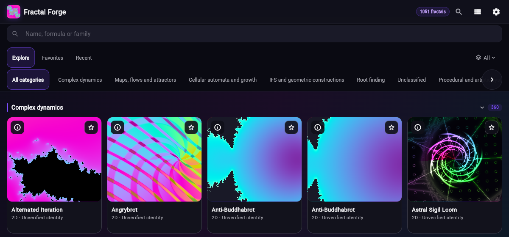
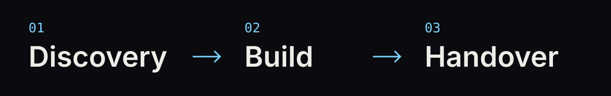

# Trebuchet Dynamics

**Serious engineering for hard systems.**

We build production software where correctness, provenance, and runtime reliability matter. Our work spans scientific computing, GPU visualization, market infrastructure, and tools for dependable agent work.

[Explore our work](https://trebuchetdynamics.com) · [Discuss a project](mailto:contact@trebuchetdynamics.com) · [LinkedIn](https://www.linkedin.com/in/juan-tamez-a3266661/)

## Public Work

### Prediction markets

- **[Arenaton](https://arenaton.com)** — Prediction-market terminal for discovery, server insights, paper trading, and wallet-controlled execution.
- **[Polyrover](https://github.com/TrebuchetDynamics/polyrover)** — Read-only async Rust SDK and CLI for public Polymarket data, streaming, and fee-aware fill simulation.
- **[Polydart](https://github.com/TrebuchetDynamics/polydart)** — Dart-native Polymarket SDK for Flutter, web, CLI, and server, with explicit signer boundaries.

### Science, research, and visualization

*Fractal Forge web app — captured from the live explorer on 2026-11-11.*

- **[Fractal Forge](https://github.com/TrebuchetDynamics/flutter-fractal-forge)** — GPU fractal explorer with real-time shaders and deep zoom. Try it on the [web](https://fractal.trebuchetdynamics.com/) or get it on [Google Play](https://play.google.com/store/apps/details?id=com.trebuchetdynamics.fractal.forge).
- **[FeCIM Lattice Tools](https://github.com/TrebuchetDynamics/fecim-lattice-tools)** — Desktop simulation lab for teaching, designing, and validating ferroelectric compute-in-memory systems.
- **[Research Forge](https://github.com/TrebuchetDynamics/research-forge)** — Source-backed research tooling that turns investigations into auditable reports and validation artifacts.

### Agent tooling

- **[Hermes Wing](https://github.com/TrebuchetDynamics/hermes-wing)** — Cross-platform mobile and desktop client for chatting with, following, and approving the work of a self-hosted Hermes Agent.
- **[Kit](https://github.com/TrebuchetDynamics/kit)** — Coding-agent skills for Pi, Claude Code, and Codex. Optional Hermes integration, a native Paseo plugin, and an optional background runner.
- **[pi-toolset](https://github.com/TrebuchetDynamics/pi-toolset)** — Curated [Pi](https://pi.dev) package for disciplined agent work: specialist skills, visible objectives, and evidence before delivery.
- **[Gormes Agent](https://github.com/TrebuchetDynamics/gormes-agent)** — Go-native agent runtime with dependable installs, diagnostics, streaming, and recoverable sessions. [gormes.ai](https://gormes.ai)

## What We Build

- **Scientific and evidence systems:** simulation, validation, citation pipelines, residual analysis, and reproducible reports.
- **GPU visualization and compute:** Vulkan, WebGPU, GLSL, compute shaders, and performance-sensitive visual tooling.
- **Runtime and backend infrastructure:** Go, Rust, CLIs, streaming systems, and durable agent and operations workflows.
- **Multi-platform products:** Android, Flutter, Vue/Nuxt, field apps, research workbenches, and consumer tools.
- **AI, retrieval, and data workflows:** agent tooling, local LLM integration, RAG, vector search, diagnostics, and data pipelines.

## How We Work

1. **Discovery before build.** Fixed-price discovery produces a technical spec, risk inventory, and build estimate.
2. **Senior-led build.** Founder-led architecture, implementation, and review. Weekly demos, green CI, working software, and clear priorities.
3. **Client-owned delivery.** You own the source, docs, runbooks, and release process from day one—not only at handover.

**Procurement-ready:** NDAs, MSAs, DPAs, IP assignment, and confidential engagements supported.

## Work With Us

We are a fit when system failure has a real cost. Correctness, evidence, performance, security, or operational reliability cannot be hand-waved.

Send the problem, constraints, timeline, and decision process to **[contact@trebuchetdynamics.com](mailto:contact@trebuchetdynamics.com)**.

---

**Trebuchet Dynamics Limited** · UK Ltd. Company No. `16997140` · D-U-N-S `234531872`

Founder building production systems since 2015 · Americas-based in-house team · No offshoring.
